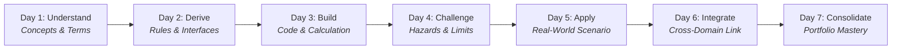

# ✈️ Aviation 365: Bitesize Learning Ecosystem

[](https://www.python.org/downloads/)
[](https://microsoft.com/windows)
[](https://www.icao.int)
[](https://docs.python.org/3/library/tkinter.html)
[](https://github.com)

> **A full-year, 365-day structured curriculum and native desktop learning studio designed to master civil aviation as an integrated system of operational, aerodynamic, technical, human, and regulatory systems.**

---

## 🧭 Project Overview & System Philosophy

Civil aviation is not a siloed set of standalone subjects. An airliner can be mechanically airworthy yet unable to push back due to crew flight duty period (FDP) limits, severe convective weather, an unassigned gate, baggage reconciliation holds, or an Air Traffic Flow Management (ATFM) departure slot.

**Aviation 365** tracks the civil flight from initial route economics and fleet planning, through ICAO/EASA certification, flight dispatch, ground turnaround, air traffic management (ATM), en-route navigation, approach, and safety management (SMS).

Every single day is accompanied by:
- **Conceptual & Regulatory Knowledge**: Formal lesson document grounded in ICAO SARPs and EASA Easy Access Rules.
- **Mathematical & Physical Derivations**: Rigorous aerodynamic and operational math (LaTeX visualization).
- **Interactive Python Simulation (`experiment.py`)**: Zero-dependency executable simulator following the 6 strict aviation engineering rules.
- **System Architecture Blueprint (`architecture.mermaid`)**: Interactive topology diagrams mapping data flows, critical paths, and failure states.
- **NotebookLM-Style Multimedia Suite**: Executive slide decks with avionics MCDU callouts, standalone vector SVG/PNG infographics, and a dual-host audio/video studio with synchronized SAPI text-to-speech.

---

## 🏛️ Pedagogical Structure

### The 7-Day Weekly Cognitive Rhythm
Each week guides the learner through a structured 7-day cognitive progression:


### The 12 Monthly Modules & Capstone Milestones

| Month | Theme | Weeks | Days | Monthly Portfolio Milestone |
|:---:|---|:---:|:---:|---|
| **01** | **What Aviation Is & How It Is Governed** | W01–W04 | 001–028 | Complete Aviation Ecosystem Map & Regulatory Hierarchy |
| **02** | **Aircraft, Flight Physics & Airworthiness** | W05–W08 | 029–056 | Aircraft Systems, CS-25 Certification & Airworthiness Lifecycle |
| **03** | **The Airline & The Flight Lifecycle** | W09–W13 | 057–091 | Airline Operating Model, Fleet Utilization & Flight Timeline |
| **04** | **Airport Infrastructure & Ground Operations** | W14–W17 | 092–119 | Aerodrome Layout, Stand Allocation & Turnaround Critical Path |
| **05** | **Passenger, Baggage & Cargo Journeys** | W18–W22 | 120–154 | End-to-End Passenger, Baggage & Cargo Tracking Architecture |
| **06** | **Airspace, ATM & Air Navigation Services** | W23–W26 | 155–182 | ANSP Service Catalogue, Sector Capacity & Conflict Geometry |
| **07** | **The Flight Through the Air** | W27–W31 | 183–217 | Phase-of-Flight Trajectory, Performance & Hazard Maps |
| **08** | **CNS, Navigation & Aeronautical Information** | W32–W35 | 218–245 | CNS/AIM Infrastructure & Cyber-Resilience Assessment |
| **09** | **Meteorology, Environment & Constraints** | W36–W39 | 246–273 | Severe Weather, Contrail Mitigation & Decarbonization Models |
| **10** | **Safety, Security & Human Performance** | W40–W44 | 274–308 | 5x5 SMS Matrix, Occurrence Investigation & Just Culture Case |
| **11** | **Aviation Technology, Data & Change** | W45–W48 | 309–336 | SWIM Architecture, Connected Aircraft & Digital Twin Systems |
| **12** | **Economics, Governance & System Mastery** | W49–W52 | 337–365 | Integrated Capstone: Whole-System Operational Aviation Model |

---

## 🖥️ Aviation 365 Studio: Desktop Interface

The studio (`studio.py`) is a native desktop application with a responsive, dark-mode cockpit aesthetic featuring **10 Integrated Tabs**:

```
+---------------------------------------------------------------------------------------------------------+
|  ✈️ AVIATION 365 STUDIO  |  DAY 028: Consolidated Regulatory Hierarchy & Ecosystem Map                  |
+---------------------------------------------------------------------------------------------------------+
| [1.Lesson] [2.Math] [3.Code] [4.Arch] [5.Terminal] [6.AI Tutor] [7.Quiz] [8.Slides] [9.Graphic] [10.Video] |
+---------------------------------------------------------------------------------------------------------+
|                                                                                                         |
|  Tab 1: 📖 Lesson Document Workspace       - Plain-English breakdown, operational context & citations  |
|  Tab 2: 📐 Math & Aerodynamic Derivations  - LaTeX-style formulas, physics calculations & derivations   |
|  Tab 3: 🐍 Python Experiment Code Editor   - Full daily simulation script with syntax highlighting      |
|  Tab 4: 🎨 System Architecture Canvas      - Interactive Mermaid rendering of states & topologies      |
|  Tab 5: 💻 Subprocess Execution Terminal   - Real-time simulation runner with interactive parameters    |
|  Tab 6: 🤖 Pedagogical AI Mentor           - Bounded Gemini tutor calibrated to the current syllabus    |
|  Tab 7: 🎯 Knowledge Assessment & Rating   - Scenario quizzes with 0-3 Star mastery tracking            |
|  Tab 8: 📽️ Executive Slide Deck           - Color-coded slides, avionics MCDU callout, jump strip      |
|  Tab 9: 📊 Vector Infographic             - High-res vector SVG & PNG graphic with KPI cards           |
|  Tab 10: 🎬 Video Overview Studio          - Dual-host SAPI TTS narration & synchronized transcript     |
|                                                                                                         |
+---------------------------------------------------------------------------------------------------------+
```

### Highlights of the Multimedia Suite (Tabs 8–10)
1. **📽️ Executive Slide Deck (Tab 8)**:
   - Dynamic category styling (Emerald for Operations, Amber for Physics, Purple for Law, Red for Hazards, Cyan for Systems).
   - **Avionics MCDU Callout**: Monospace FMS/MCDU technical specification box (`#020617` / `#4ade80`).
   - Interactive `[01] [02] ... [N]` slide jump strip and dedicated presenter speaker notes.
2. **📊 AI Vector Infographics (Tab 9)**:
   - Generated as standalone vector SVGs (`infographic.svg`) featuring radar coordinate grids, 3 KPI metric tiles, 4 core pillar breakdown cards, and statutory hazard alerts.
   - Automatically rasterized to high-res PNGs (`infographic.png`) using PyMuPDF.
   - Built-in **`🌐 Open Vector SVG (Browser)`** button for infinite zooming and crisp viewing.
3. **🎬 Video Overview & SAPI TTS Engine (Tab 10)**:
   - **Dual-Voice Audio Narration**: Synthesized using Windows Speech API (`win32com.client.Dispatch("SAPI.SpVoice")`), providing authentic conversational pacing between **Capt. Marcus Ross** (Voice 0) and **Dr. Elena Vance** (Voice 1).
   - **Chapter Infographics on Stage**: Renders high-contrast chapter slides with concept summaries, KPI badges, and visual schematics.
   - **Synchronized Playback**: Asynchronous audio playback (`winsound`) synchronized with frame transitions, timeline scrubber, elapsed timecode, and auto-scrolling active transcript cards.

---

## ⚡ The 6 Aviation Experiment Engineering Rules

Every simulation script in `learned/week-XX/day-YYY/experiment.py` adheres to strict operational standards:
1. **Interactive Parameter Prompts**: Every key variable prompts with operational defaults on `<Enter>`.
2. **Unbuffered UTF-8 Output**: Flushed terminal output ensures instant feedback during iterative calculations.
3. **Transparent Intermediate Mechanics**: Outputs step-by-step aerodynamic, performance, and risk intermediate calculations.
4. **Adversarial Stress Testing**: Evaluates boundary limits, exceedances, and failure modes (e.g. crosswind limits, single-engine drift down, FDP limits).
5. **Runtime Benchmarking**: Precision timing to microsecond accuracy.
6. **Zero External Dependencies**: Pure Python standard library (`math`, `time`, `sys`, `json`) — guaranteed to run on any machine.

---

## 🤖 AI Curriculum & Multimedia Generation Engines

Aviation 365 provides automated generation capabilities powered by Google Gemini:

### 1. Curriculum & Lesson Generator (`curriculum_generator.py`)
Allows users to clone a "blank slate" repository and generate or regenerate daily lessons, math derivations, interactive experiments, and Mermaid architecture diagrams:
```bash
# Generate a specific day from the syllabus
python curriculum_generator.py --day 28

# Regenerate an entire week
python curriculum_generator.py --week 4

# Check generation status
python curriculum_generator.py --status
```

### 2. NotebookLM Multimedia Studio Generator (`notebooklm_studio.py`)
Generates executive slides, vector SVG/PNG infographics, and dual-host audio/video overviews:
```bash
# Generate multimedia artifacts for Day 28
python notebooklm_studio.py --day 28

# Generate multimedia for all days in Week 4
python notebooklm_studio.py --week 4
```

---

## 🚀 Quick Start Guide

### Prerequisites
- **Operating System**: Windows 10/11 (fully leverages Windows SAPI audio and native desktop rendering).
- **Python**: Version 3.10 or higher.
- *(Optional)* Gemini API Key for AI generation features.

### Installation

1. **Clone the repository**:
   ```bash
   git clone https://github.com/SDMCNS/365-days-of-aviation.git
   cd 365-days-of-aviation
   ```

2. **Install optional packages for vector rendering & AI**:
   ```bash
   pip install pymupdf google-genai pillow
   ```

3. **Launch the Studio Application**:
   Simply double-click the Windows batch launcher:
   ```cmd
   Aviation-Studio.bat
   ```
   Or launch directly via terminal:
   ```bash
   python studio.py
   ```

4. **Running Daily Experiments from CLI**:
   ```bash
   python learned/week-01/day-001/experiment.py
   python learned/week-04/day-028/experiment.py
   ```

---

## ⚖️ Statutory & Regulatory Framework

Aviation 365 is grounded in international civil aviation law and technical regulations:
- **International Civil Aviation Organization (ICAO)**:
  - *Chicago Convention (Doc 7300)* and Annexes 1–19.
  - *PANS-ATM (Doc 4444)*, *PANS-OPS (Doc 8168)*.
  - *Safety Management Manual (Doc 9859)*, *Global Air Navigation Plan (Doc 9750)*.
- **European Union & EASA**:
  - *Basic Regulation (EU) 2018/1139*.
  - *Air Operations (Regulation (EU) No 965/2012)*: Part-CAT, Part-SPA, Part-NCC, Part-ORO.
  - *Airworthiness (Regulation (EU) No 748/2012 & No 1321/2014)*: Part-21, Part-M, Part-145, Part-CAMO.
  - *Certification Specifications*: CS-25 (Large Aeroplanes), CS-E (Engines), CS-AWO (All Weather Operations).
  - *Aerodromes & ATM*: Regulation (EU) No 139/2014, Regulation (EU) 2017/373, Regulation (EU) No 255/2010.

---

## 📁 Repository Directory Structure

```
365-days-of-aviation/
├── Aviation-Studio.bat           # One-click Windows desktop studio launcher
├── studio.py                     # Native Tkinter 10-tab cockpit learning studio
├── curriculum_generator.py       # Gemini curriculum & lesson synthesis engine
├── notebooklm_studio.py          # Slide, SVG infographic & TTS video generator
├── 365 Days of Aviation.md       # Master 365-day syllabus & taxonomy register
├── README.md                     # Comprehensive documentation & guide
├── .gitignore                    # Git ignore file protecting API keys & caches
├── lessons/                      # Core lesson documents (Weeks 01-52)
│   ├── week-01/ ... week-52/
│   │   └── day-001.md ... day-365.md
└── learned/                      # Practical daily engineering artifacts
    ├── week-01/ ... week-52/
        └── day-001/ ... day-365/
            ├── analysis.md        # Plain-English operational deep-dive
            ├── math.md            # Aerodynamic/operational formulas & math
            ├── experiment.py      # Standalone interactive Python simulator
            ├── architecture.mermaid # System & turnaround state diagrams
            ├── slides.json / .md  # Executive slide deck & presenter notes
            ├── infographic.svg    # Standalone vector SVG infographic
            ├── infographic.png    # Rasterized high-resolution PNG
            ├── video_overview.json# Audio dialogue script with turn timing
            ├── video_overview.wav # Dual-voice SAPI synthesized audio
            └── video_overview.webp# Synchronized animated video overview
```

---

## 📄 License & Attribution

Distributed under the MIT License. Grounded strictly in public international civil aviation standards (ICAO & EASA). Built for aerospace students, airline dispatchers, pilot trainees, ATM controllers, and aviation software engineers.
