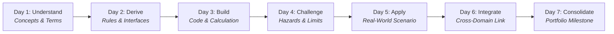

# ✈️ Aviation 365: Bitesize Learning Ecosystem

[](https://www.python.org/downloads/)
[](https://microsoft.com/windows)
[](https://www.icao.int)
[](https://docs.python.org/3/library/tkinter.html)
[](https://github.com/SDMCNS/365-days-of-aviation)

> **A full-year, 365-day structured curriculum and native desktop learning studio designed to teach civil aviation as an integrated operational, aerodynamic, technical, human, and regulatory system of systems.**

---

## 🧭 Project Architecture & System Philosophy

Civil aviation is not a collection of independent disciplines. An airliner can be mechanically airworthy yet unable to push back due to crew flight duty period (FDP) limits, convective weather along the SID, an unassigned stand, baggage security reconciliation holds, or an Air Traffic Flow Management (ATFM) departure slot.

**Aviation 365** tracks civil aviation operations from commercial network planning and aircraft certification, through dispatch, airport turnaround, air traffic management (ATM), en-route navigation, approach, and safety management (SMS).

### What Is Included in the Repository
- **365 Lesson Plans (`lessons/week-01/` to `lessons/week-52/`)**: Grounded in ICAO Standards and Recommended Practices (SARPs) and EASA Easy Access Rules.
- **365 Interactive Simulators (`learned/.../experiment.py`)**: Zero-dependency Python CLI programs adhering to 6 strict aviation engineering rules.
- **365 System Architecture Blueprints (`learned/.../architecture.mermaid`)**: Mermaid topology diagrams mapping system states, data interfaces, and failure paths.
- **365 Mathematical & Physical Walkthroughs (`learned/.../math.md`)**: Formulas and step-by-step derivations (Breguet range, weight & balance, runway performance, ATM conflict geometry).
- **Month 01 Showcase (Days 001–028)**: In-depth operational analyses (`analysis.md`) establishing the foundational aviation ecosystem.
- **Day 028 Multimedia Showcase**: Fully pre-compiled NotebookLM-style multimedia artifacts (`slides.json/.md`, `infographic.svg/.png`, and `video_overview.wav/.webp`).
- **On-Demand Generation Engines**: Standalone CLI and UI generators to synthesize or regenerate lessons, code, slides, vector infographics, and dual-host audio overviews for any day in the 365-day syllabus.

---

## 🏛️ Pedagogical Structure

### The 7-Day Weekly Cognitive Rhythm
Every week guides the student through a disciplined 7-day progression:


### The 12 Monthly Modules & Capstone Milestones

| Month | Theme | Weeks | Days | Monthly Portfolio Milestone |
|:---:|---|:---:|:---:|---|
| **01** | **What Aviation Is & How It Is Governed** | W01–W04 | 001–028 | Complete Aviation Ecosystem Map & Regulatory Hierarchy |
| **02** | **Aircraft, Flight Physics & Airworthiness** | W05–W08 | 029–056 | Aircraft Systems, CS-25 Certification & Airworthiness Lifecycle |
| **03** | **The Airline & The Flight Lifecycle** | W09–W13 | 057–091 | Airline Operating Model, Fleet Utilization & Flight Timeline |
| **04** | **Airport Infrastructure & Ground Operations** | W14–W17 | 092–119 | Aerodrome Layout, Stand Allocation & Turnaround Critical Path |
| **05** | **Passenger, Baggage & Cargo Journeys** | W18–W22 | 120–154 | End-to-End Passenger, Baggage & Cargo Tracking Architecture |
| **06** | **Airspace, ATM & Air Navigation Services** | W23–W26 | 155–182 | ANSP Service Catalogue, Sector Capacity & Conflict Geometry |
| **07** | **The Flight Through the Air** | W27–W31 | 183–217 | Phase-of-Flight Trajectory, Performance & Hazard Maps |
| **08** | **CNS, Navigation & Aeronautical Information** | W32–W35 | 218–245 | CNS/AIM Infrastructure & Cyber-Resilience Assessment |
| **09** | **Meteorology, Environment & Constraints** | W36–W39 | 246–273 | Severe Weather, Contrail Mitigation & Decarbonization Models |
| **10** | **Safety, Security & Human Performance** | W40–W44 | 274–308 | 5x5 SMS Matrix, Occurrence Investigation & Just Culture Case |
| **11** | **Aviation Technology, Data & Change** | W45–W48 | 309–336 | SWIM Architecture, Connected Aircraft & Digital Twin Systems |
| **12** | **Economics, Governance & System Mastery** | W49–W52 | 337–365 | Integrated Capstone: Whole-System Operational Aviation Model |

---

## 🖥️ Aviation 365 Studio: Desktop Interface

The desktop studio (`studio.py`) is written in native Python Tkinter with a dark-mode cockpit aesthetic. It provides a tabbed workspace designed for interactive learning:

```
+---------------------------------------------------------------------------------------------------------------+
|  ✈️ Aviation 365 STUDIO  |  Day 028: Consolidated Regulatory Hierarchy & Ecosystem Map                       |
+---------------------------------------------------------------------------------------------------------------+
| [1.Lesson] [2.Tech Walkthrough] [3.Python Tool] [4.Topology] [5.Console] [6.AI Mentor] [7.Scenario Quiz]      |
|                                                  [8.Slide Deck] [9.Infographic] [10.Video Overview]           |
+---------------------------------------------------------------------------------------------------------------+
|                                                                                                               |
|  Core Workspace Tabs (Available for all 365 Days):                                                            |
|  • Tab 1: 📖 Lesson Document      - Syllabus objectives, operational narrative, and statutory citations        |
|  • Tab 2: 📊 Technical Walkthrough - Formulas, aerodynamic physics, and step-by-step mathematical working       |
|  • Tab 3: 🐍 Operational Python Tool- Syntax-highlighted daily simulation script                             |
|  • Tab 4: 🗺️ System Topology      - Interactive Mermaid rendering of state transitions and data flows          |
|  • Tab 5: 💻 Execution Console    - Real-time subprocess runner with interactive parameter inputs             |
|  • Tab 6: 🤖 Aviation AI Specialist- Contextual Gemini tutor bounded to current day's aviation concepts       |
|  • Tab 7: 🎯 Scenario Assessment  - Operational decision scenarios with 0–3 Star mastery scoring             |
|                                                                                                               |
|  Multimedia Extension Tabs (Active when generated for the selected day; showcase on Day 028):                |
|  • Tab 8: 📽️ Slide Deck           - Color-coded category slides, avionics MCDU callouts, slide jump strip     |
|  • Tab 9: 🖼️ Infographic          - Vector SVG & high-res PNG layout with KPI cards and in-browser inspection  |
|  • Tab 10: 🎬 Video Overview       - Synchronized dual-host audio narration (Capt. Marcus & Dr. Elena Vance)    |
|                                                                                                               |
+---------------------------------------------------------------------------------------------------------------+
```

---

## ⚡ The 6 Aviation Experiment Engineering Rules

Every one of the 365 simulation scripts (`learned/week-XX/day-YYY/experiment.py`) is built to the same strict standards:
1. **Interactive Parameter Prompts**: Every key variable prompts with operational defaults on `<Enter>`.
2. **Unbuffered UTF-8 Output**: Flushed output ensures clean display when executed in external consoles or within the Studio runner.
3. **Transparent Intermediate Mechanics**: Outputs step-by-step intermediate aerodynamic, performance, or risk calculations rather than black-box results.
4. **Adversarial Stress Testing**: Evaluates operational boundary limits, exceedances, and failure states (e.g. crosswind limits, single-engine drift down, FDP limits).
5. **Runtime Benchmarking**: Reports execution time in microseconds.
6. **Zero External Dependencies**: Uses only the Python standard library (`math`, `time`, `sys`, `json`) — runs out of the box on any Python 3.10+ setup.

---

## 🤖 On-Demand AI Generation Engines

For users who want to expand or generate detailed content beyond the core curriculum:

### 1. Curriculum & Lesson Generator (`curriculum_generator.py`)
Generates or regenerates deep operational analyses, math derivations, interactive experiments, and Mermaid diagrams from the master syllabus using Google Gemini:
```bash
# Generate content for Day 28
python curriculum_generator.py --day 28

# Regenerate an entire week (e.g., Week 4)
python curriculum_generator.py --week 4

# Check curriculum status across all 52 weeks
python curriculum_generator.py --status
```

### 2. NotebookLM Multimedia Studio Generator (`notebooklm_studio.py`)
Generates executive slide decks, standalone vector SVG/PNG infographics, and dual-host audio/video scripts:
```bash
# Generate multimedia artifacts for Day 28
python notebooklm_studio.py --day 28

# Generate multimedia for all days in Week 4
python notebooklm_studio.py --week 4
```
*Note: Audio generation utilizes the native Windows Speech API (`SAPI.SpVoice` via `win32com.client`), requiring no external TTS cloud services.*

---

## 🚀 Quick Start Guide

### System Requirements
- **Operating System**: Windows 10/11 (fully leverages Windows SAPI audio and native desktop rendering).
- **Python**: Version 3.10 or higher.
- *(Optional)* Gemini API Key for on-demand generation (`.aviation_config.json`).

### Installation

1. **Clone the repository**:
   ```bash
   git clone https://github.com/SDMCNS/365-days-of-aviation.git
   cd 365-days-of-aviation
   ```

2. **(Optional) Install recommended packages for vector rasterization & AI**:
   ```bash
   pip install pymupdf google-genai pillow
   ```

3. **Launch the Studio Application**:
   Double-click the Windows batch launcher:
   ```cmd
   Aviation-Studio.bat
   ```
   Or run from terminal:
   ```bash
   python studio.py
   ```

4. **Running Daily Experiments from CLI**:
   ```bash
   python learned/week-01/day-001/experiment.py
   python learned/week-04/day-028/experiment.py
   ```

---

## 📁 Repository Directory Structure

```
365-days-of-aviation/
├── Aviation-Studio.bat           # Windows desktop launcher
├── studio.py                     # Native Tkinter 10-tab cockpit learning studio
├── curriculum_generator.py       # Gemini curriculum & lesson synthesis engine
├── notebooklm_studio.py          # Slide, SVG infographic & TTS video generator
├── 365 Days of Aviation.md       # Master 365-day syllabus & taxonomy register
├── README.md                     # Documentation & ecosystem overview
├── .gitignore                    # Protects API keys, progress files, and local caches
├── lessons/                      # Core lesson documents across all 52 weeks
│   ├── week-01/ ... week-52/
│   │   └── day-001.md ... day-365.md
└── learned/                      # Practical daily engineering artifacts
    ├── week-01/ ... week-52/
        └── day-001/ ... day-365/
            ├── README.md          # Daily overview & exercise guidelines (all 365 days)
            ├── math.md            # Formulas & derivations (all 365 days)
            ├── experiment.py      # Standalone interactive Python simulator (all 365 days)
            ├── architecture.mermaid # System state diagrams (all 365 days)
            ├── analysis.md        # Detailed operational analysis (Month 01 showcase; on-demand)
            ├── slides.json / .md  # Executive slide deck (Day 028 showcase; on-demand)
            ├── infographic.svg    # Standalone vector SVG infographic (Day 028 showcase; on-demand)
            ├── infographic.png    # Rasterized high-res PNG (Day 028 showcase; on-demand)
            ├── video_overview.json# Dialogue turns with timestamps (Day 028 showcase; on-demand)
            ├── video_overview.wav # Dual-voice SAPI synthesized audio (Day 028 showcase; on-demand)
            └── video_overview.webp# Synchronized animated video overview (Day 028 showcase; on-demand)
```

---

## ⚖️ Statutory & Regulatory Framework

Aviation 365 is grounded in civil aviation statutory baselines:
- **International Civil Aviation Organization (ICAO)**:
  - *Chicago Convention (Doc 7300)* and Annexes 1–19.
  - *PANS-ATM (Doc 4444)*, *PANS-OPS (Doc 8168)*.
  - *Safety Management Manual (Doc 9859)*, *Global Air Navigation Plan (Doc 9750)*.
- **European Union & EASA**:
  - *Basic Regulation (EU) 2018/1139*.
  - *Air Operations (Regulation (EU) No 965/2012)*: Part-CAT, Part-SPA, Part-NCC, Part-ORO.
  - *Airworthiness (Regulation (EU) No 748/2012 & No 1321/2014)*: Part-21, Part-M, Part-145, Part-CAMO.
  - *Certification Specifications*: CS-25 (Large Aeroplanes), CS-E (Engines), CS-AWO (All Weather Operations).
  - *Aerodromes & ATM*: Regulation (EU) No 139/2014, Regulation (EU) 2017/373, Regulation (EU) No 255/2010.

---

## 📄 License & Attribution

Distributed under the MIT License. Grounded in public civil aviation standards (ICAO & EASA). Built for aerospace students, airline dispatchers, pilot trainees, ATM controllers, and aviation systems engineers.
